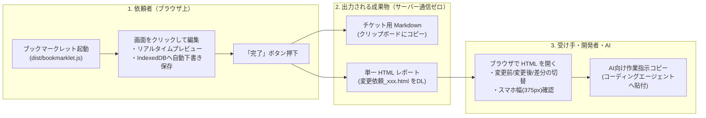
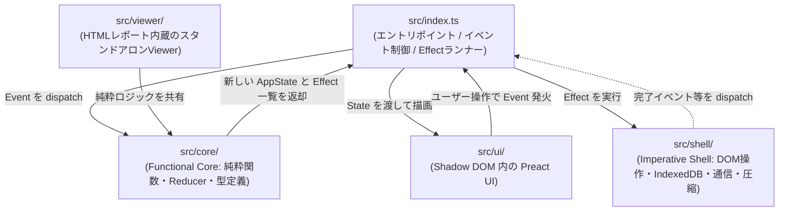

# 赤ペン（page-change-request）アーキテクチャ解説

このドキュメントでは、「赤ペン（`page-change-request`）」が**全体としてどのようなアーキテクチャで構成され、何をどう組み合わせることで成り立っているのか**を解説します。

---

## 1. このアプリケーションは何を実現しているのか？

Web制作や開発の現場で発生する「ここの文言を変えてほしい」「このリンク先を直してほしい」「この画像を差し替えてほしい」といった変更依頼を、**対象ページをブラウザで直接クリック・編集するだけで完結させるツール**です。

最大の特徴は、**外部サーバーやブラウザ拡張機能を一切使わず、「1つのブックマークレット」と「1つの出力HTMLファイル」だけで全てのワークフローが完結する**点にあります。

---

## 2. 全体を貫く4つの設計ピラー（どう成り立っているか）

このアプリケーションは、以下の4つの仕組みが噛み合うことで成り立っています。

### ① 2段ビルドによる「マトリョーシカ構造」（Viewer-in-Bookmarklet）
ブックマークレットは外部サーバーを持たないため、「完了」を押したときにダウンロードさせる**レポート閲覧用アプリ（Viewer）自体も、ブックマークレットのコードの中に最初から内蔵**されています。

* **仕組み（[`scripts/build.ts`](file:///Users/kyoya/Desktop/dev/akapen/scripts/build.ts)）**:
  1. まずレポート閲覧用の [`src/viewer/index.ts`](file:///Users/kyoya/Desktop/dev/akapen/src/viewer/index.ts) と [`src/viewer/styles.ts`](file:///Users/kyoya/Desktop/dev/akapen/src/viewer/styles.ts) を esbuild でバンドル・圧縮します。
  2. そのコードを **Gzip圧縮＋Base64化** し、さらに改ざん防止・CSP許可用の **SHA-256ハッシュ** を計算して、自動生成ファイル（`src/viewer/embedded-bundle.ts`）に書き出します。
  3. それをブックマークレット本体（[`src/index.ts`](file:///Users/kyoya/Desktop/dev/akapen/src/index.ts)）が import して1つの IIFE バンドル（`dist/bookmarklet.js`、100KB以下）にまとめ、ドラッグ＆ドロップ登録用の [`install.html`](file:///Users/kyoya/Desktop/dev/akapen/install.html) を生成します。

### ② Functional Core / Imperative Shell（純粋ロジックと副作用の分離）
コードベースは明確にレイヤー分けされており、複雑な状態管理とブラウザ固有のドロドロしたDOM操作が混ざらない設計になっています。

* **`src/core/`（純粋ロジック層）**:
  * [`state.ts`](file:///Users/kyoya/Desktop/dev/akapen/src/core/state.ts) は Elm Architecture / Redux ライクな純粋 Reducer です。`update(state, event)` は副作用を一切行わず、`{ state, effects }`（新しい状態と、実行すべき副作用コマンドの配列）だけを返します。
* **`src/shell/`（副作用層）**:
  * [`index.ts`](file:///Users/kyoya/Desktop/dev/akapen/src/index.ts) の `runEffect` が `SYNC_LIVE_DOM`（画面の書き換え）や `CAPTURE_SNAPSHOT_FOR_ITEM`（スナップショット取得）、`SAVE_DRAFT_DEBOUNCED`（IndexedDB保存）などの副作用を実行します。

### ③ 対象ページを壊さない「非破壊オーバーレイ＆ライブプレビュー」
任意のWebサイト（特に React や Next.js などの SPA）の上で動くため、「対象サイトの見た目や挙動を壊さないこと」が最優先されています。

1. **Shadow DOM による UI 隔離（[`src/shell/dom-overlay.ts`](file:///Users/kyoya/Desktop/dev/akapen/src/shell/dom-overlay.ts)）**:
   * ツールバーやポップオーバー編集画面、赤枠ハイライトはすべて `#pcr-bookmarklet-host` の **Shadow DOM** 内に Preact で描画されます。対象ページの CSS とツールの CSS が互いに干渉しません。
2. **イベントのインターセプト（[`src/index.ts`](file:///Users/kyoya/Desktop/dev/akapen/src/index.ts)）**:
   * `window` のキャプチャフェーズでクリックやポインタイベントを捕捉し、リンク遷移などの本来の動作を止めつつ要素を選択します（`Alt` / `Option` キー押下中や「一時停止」中だけ本来のページ操作を通します）。
3. **SPA をクラッシュさせないライブプレビュー（[`src/shell/live-preview.ts`](file:///Users/kyoya/Desktop/dev/akapen/src/shell/live-preview.ts)）**:
   * React 等が管理している DOM ノード自体を差し替える（`innerHTML` や子要素の削除など）と、フレームワークの再描画時に例外（`removeChild` エラー等）が起きます。
   * そのため、**既存の Text ノードの `nodeValue` と要素の属性（`href`, `src`, `style`）だけをピンポイントで書き換え、元の値をメモリに記憶**します。
   * スナップショットを撮る瞬間や元のテキストを測る瞬間だけ、`withCleanDom()` によって**一瞬だけ変更前のクリーンな DOM に戻し、処理が終わったら即座にプレビューを当て直す**という巧妙な仕組みを持っています。
   * さらに `MutationObserver` でページ側の再描画を監視し、ページ側が DOM を作り直したら自動でプレビューを当て直します（ツール自身の書き換えは `beforeMutate` / `afterMutate` フックで無視します）。

### ④ 多重アンカー解決（どうやって要素を特定・追跡するか）
「どの要素に対する変更か」を特定するために、単一の CSS セレクタだけに頼るのではなく、[`src/core/anchor.ts`](file:///Users/kyoya/Desktop/dev/akapen/src/core/anchor.ts) で複数の手がかり（[`ElementLocator`](file:///Users/kyoya/Desktop/dev/akapen/src/core/types.ts)）を同時に記録します。

| 手がかり | 内容と用途 |
| :--- | :--- |
| **`selector`（CSSセレクタ）** | `@medv/finder` で生成。ただし CSS Modules や CSS-in-JS（`css-xxx`, `sc-xxx`）、React の動的 ID（`:r1:` 等）などの**不安定なクラス・IDを除外**して生成します。 |
| **`textQuote`（前後文脈つきテキスト）** | 対象テキスト（`exact`）だけでなく、ページ全文の中での**直前32文字（`prefix`）・直後32文字（`suffix`）**を記録します。クラス名が動的でも文脈スコアで正確に要素を再特定でき、AI がソースコードを全文検索する際の手がかりにもなります。 |
| **`domPath`（DOMツリー経路）** | `documentElement` から何番目の子要素かを辿るインデックス配列（例: `[1, 0, 3, 2]`）。保存したスナップショット（クローンDOM）内で確実に同じ要素を指し示すために使います。 |
| **`rect` / `ratio`（座標・相対比率）** | 要素の矩形座標や、範囲ドラッグ選択（`region`）時の親コンテナに対する相対比率。万が一要素が消えた場合のフォールバック表示に使われます。 |

---

## 3. 主要なデータフロー（起動から出力・閲覧まで）

### Step 1: 変更の確定とバックグラウンドでのスナップショット取得
ユーザーが要素をクリックして文言や画像を変更し「確定」を押すと、[`state.ts`](file:///Users/kyoya/Desktop/dev/akapen/src/core/state.ts) の `CONFIRM_EDITOR` が走ります。

1. **即時反映**: スナップショットの撮影完了を待たず、即座に一覧・番号バッジ・ライブプレビュー（`SYNC_LIVE_DOM`）へ反映して UI のレスポンスを保ちます。
2. **クリーンな DOM スナップショットの取得（[`src/shell/snapshot-io.ts`](file:///Users/kyoya/Desktop/dev/akapen/src/shell/snapshot-io.ts)）**:
   * `withCleanDom` でライブプレビューを一時解除した状態で `documentElement.cloneNode(true)` を実行します。
   * **無害化（[`src/core/sanitize.ts`](file:///Users/kyoya/Desktop/dev/akapen/src/core/sanitize.ts)）**: `<input>` や `<textarea>` の入力値（個人情報）、CSRFトークン、`<script>`、`onclick` 等のイベント属性をすべて除去します。ただし `domPath`（要素の順番）がズレないよう、削除する要素は空の `<template>` タグに置き換えます。
   * **完全オフライン化**: 外部 CSS や CSS-in-JS（`CSSStyleSheet.cssRules` / `adoptedStyleSheets`）をすべて `<style>` タグとしてインライン化し、`<canvas>` は画像化し、ページ内の画像は `fetch` して SHA-256 ハッシュをキーにしたリソース辞書（最大合計10MB）へ格納し、HTML内の URL を `pcr-res:<hash>` に書き換えます。
   * 完成した HTML 文字列をブラウザ標準の `CompressionStream("gzip")`（[`src/shell/codec.ts`](file:///Users/kyoya/Desktop/dev/akapen/src/shell/codec.ts)）で Gzip＋Base64 圧縮します（同じURLでDOMも画面幅も変わっていなければ、前回のスナップショットを再利用します）。
3. **IndexedDB への自動保存（[`src/shell/storage-idb.ts`](file:///Users/kyoya/Desktop/dev/akapen/src/shell/storage-idb.ts)）**:
   * 変更アイテム（`drafts`）、圧縮済みHTML（`snapshotBodies`）、画像バイナリ（`resources`）の3つのストアに分けてデバウンス保存します。これにより、**同一サイト内の別ページへ画面遷移しても、もう一度ブックマークレットを押せば下書きがそのまま引き継がれます**。

### Step 2: 「完了」時のエクスポート処理
ツールバーの「完了」を押すと、[`src/index.ts`](file:///Users/kyoya/Desktop/dev/akapen/src/index.ts) の `exportReport` が実行されます。

1. 取り消された変更からしか参照されていない不要なスナップショットや画像をフィルタリングして除外します（`filterReferencedReportAssets`）。
2. [`src/core/markdown.ts`](file:///Users/kyoya/Desktop/dev/akapen/src/core/markdown.ts) で Redmine や GitHub Issues にそのまま貼れる **チケット用 Markdown** を生成し、クリップボードにコピーします。
3. [`src/shell/export-io.ts`](file:///Users/kyoya/Desktop/dev/akapen/src/shell/export-io.ts) で、以下のデータを埋め込んだ **単一 HTML ファイル** を組み立ててダウンロードさせます。
   * `<script type="application/json" id="pcr-data">`: 変更依頼のメタデータと変更リスト（`ChangeRequestDoc`）
   * `<script type="application/json" id="pcr-snapshots">`: Gzip＋Base64 圧縮された各ページの HTML スナップショット
   * `<script type="application/json" id="pcr-resources">`: Base64 化された画像リソース群（コンテンツハッシュで重複排除済み）
   * `<script>`: ビルド時に埋め込んでおいた Viewer スクリプト本体

### Step 3: 単一 HTML レポートの安全な閲覧と AI 連携
ダウンロードされた HTML ファイルをブラウザで開くと、内蔵された [`src/viewer/index.ts`](file:///Users/kyoya/Desktop/dev/akapen/src/viewer/index.ts) が起動します。

1. **鉄壁のセキュリティ（CSP + Sandboxed iframe）**:
   * レポート HTML 自体に厳格な `Content-Security-Policy`（`default-src 'none'`, `script-src 'sha256-...'`, `img-src data: blob:` 等）が設定されており、**レポートを開いても元サイトや外部へ一切のネットワーク通信が発生しません**。
   * 画面プレビューは `sandbox="allow-same-origin"`（スクリプト実行不可）の `<iframe>` 内に描画されます。
2. **「変更前 / 変更後 / 差分」の動的合成（[`src/core/preview.ts`](file:///Users/kyoya/Desktop/dev/akapen/src/core/preview.ts)）**:
   * Viewer はスナップショットを3パターン保存しているわけではありません。**1つのクリーンな変更前スナップショット HTML をブラウザ上で Gzip 展開し、`DOMParser` でパースした上で、`domPath` を使って変更内容（変更後テキストや文字単位の Diff ハイライト、画像の Blob URL）を動的に当て直して `iframe.srcdoc` に流し込んでいます**。
   * これにより、HTML ファイルサイズを最小限に抑えつつ、「変更前」「変更後」「差分」の瞬時切り替えと、PC幅 / スマホ幅（`375px`）の切り替えを実現しています。
3. **AI コーディングエージェント向けの作業指示出力**:
   * Viewer 右上の「作業指示としてコピー」を押すと、[`generateAiInstructionMarkdown`](file:///Users/kyoya/Desktop/dev/akapen/src/core/markdown.ts) が呼ばれます。
   * ここには「変更前後の原文（エスケープなしのコードブロック）」「直前・直後の文脈（TextQuote）」「要素タグと参考セレクタ」が構造化されて出力されるため、Claude Code や Cursor などの AI エージェントにそのまま貼り付けるだけで、リポジトリ内の該当箇所を正確に Grep・特定してコード修正まで自動化できるよう設計されています。

---

## 4. ディレクトリと主要ファイルの役割早見表

| ディレクトリ / ファイル | 役割 |
| :--- | :--- |
| **[`src/index.ts`](file:///Users/kyoya/Desktop/dev/akapen/src/index.ts)** | ブックマークレットの起動エントリポイント。ポインタ/キーボードイベントの捕捉、`requestAnimationFrame` による描画ループ、純粋 Reducer（`update`）の呼び出しと副作用（`Effect`）の実行を統括する。 |
| **[`src/core/types.ts`](file:///Users/kyoya/Desktop/dev/akapen/src/core/types.ts)** | アプリ全体のデータモデル（`Item`, `Anchor`, `ElementLocator`, `ChangeRequestDoc` など）の型定義。 |
| **[`src/core/state.ts`](file:///Users/kyoya/Desktop/dev/akapen/src/core/state.ts)** | アプリケーションの状態（`AppState`）とイベント（`AppEvent`）、副作用（`Effect`）を定義する純粋 Reducer。 |
| **[`src/core/anchor.ts`](file:///Users/kyoya/Desktop/dev/akapen/src/core/anchor.ts)** | 要素の特定・再解決ロジック（安定セレクタ生成、前後文脈 `TextQuote` の抽出・マッチング）。 |
| **[`src/core/sanitize.ts`](file:///Users/kyoya/Desktop/dev/akapen/src/core/sanitize.ts)** | スナップショット取得時の個人情報（フォーム入力値）・スクリプト・危険なURLの無害化、および画像URLのハッシュ置換。 |
| **[`src/core/preview.ts`](file:///Users/kyoya/Desktop/dev/akapen/src/core/preview.ts)** | 文字単位の差分計算（LCSベース）と、レポート Viewer のクローン DOM に対する「変更前 / 変更後 / 差分」状態の適用ロジック。 |
| **[`src/core/markdown.ts`](file:///Users/kyoya/Desktop/dev/akapen/src/core/markdown.ts)** | チケット貼り付け用 Markdown と、AI エージェント向け作業指示プロンプトの生成ロジック。 |
| **[`src/shell/dom-overlay.ts`](file:///Users/kyoya/Desktop/dev/akapen/src/shell/dom-overlay.ts)** | Shadow DOM ホストの作成、クリック対象要素の判定、選択範囲の親要素への拡大/縮小、要素座標の計測。 |
| **[`src/shell/live-preview.ts`](file:///Users/kyoya/Desktop/dev/akapen/src/shell/live-preview.ts)** | 対象ページの DOM ノードを壊さずに文字・属性だけを書き換えるリアルタイムプレビュー制御と、クリーン DOM の一時復元（`withCleanDom`）。 |
| **[`src/shell/snapshot-io.ts`](file:///Users/kyoya/Desktop/dev/akapen/src/shell/snapshot-io.ts)** | クリーン DOM のクローン、外部 CSS / CSS-in-JS のインライン化、画像の取得・容量予算管理（10MB上限）、添付画像の WebP 圧縮。 |
| **[`src/shell/storage-idb.ts`](file:///Users/kyoya/Desktop/dev/akapen/src/shell/storage-idb.ts)** | IndexedDB を用いたページ跨ぎの下書き・スナップショット・画像リソースの自動保存と有効期限管理。 |
| **[`src/shell/export-io.ts`](file:///Users/kyoya/Desktop/dev/akapen/src/shell/export-io.ts)** | 厳格な CSP ヘッダを付与した単一 HTML レポートの組み立てとファイルダウンロード発火。 |
| **[`src/ui/app.tsx`](file:///Users/kyoya/Desktop/dev/akapen/src/ui/app.tsx)** | Shadow DOM 内にマウントされる Preact 製のオーバーレイ UI（ツールバー、ポップオーバーエディタ、バッジ、素早い一覧）。 |
| **[`src/viewer/index.ts`](file:///Users/kyoya/Desktop/dev/akapen/src/viewer/index.ts)** | 出力された HTML レポート内で動くスタンドアロン Viewer（iframe プレビュー、差分カード一覧、コピーボタン）。 |
| **[`scripts/build.ts`](file:///Users/kyoya/Desktop/dev/akapen/scripts/build.ts)** | Viewer をビルドして Gzip+Base64 で本体へ埋め込み、100KB 以下のブックマークレットと `install.html` を出力する2段ビルドスクリプト。 |
